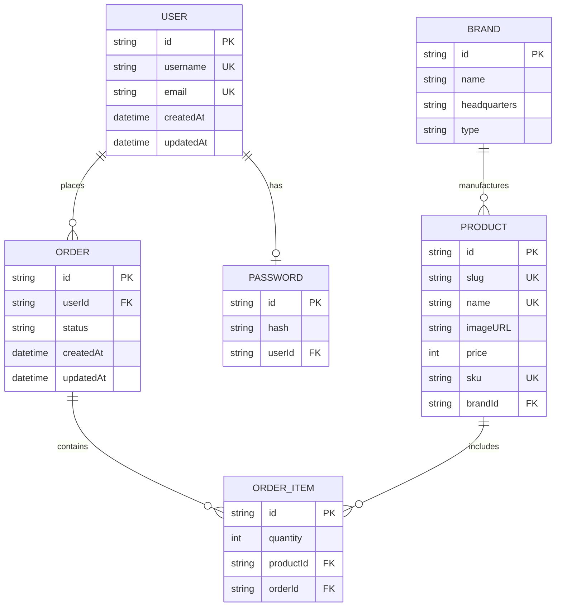

# Tech Spot 📱

> Modern Full-Stack Smartphone & Gadget E-Commerce Ecosystem.

Tech Spot adalah platform toko online modern untuk berbagai macam smartphone dan perangkat mobile dengan arsitektur micro-service / decoupled (Frontend Vite/React + Backend Hono/Prisma/PostgreSQL).

---

## 🌐 Arsitektur & Tautan Repositori

| Layanan | Repositori GitHub | Teknologi Utama | Status |
|:---|:---|:---|:---|
| **Blueprint & Arsitektur** | [josapratama/techspot](https://github.com/josapratama/techspot) | ERD, SQL Schema, Arsitektur Sistem | Ready |
| **Backend REST API** | [josapratama/techspot-backend](https://github.com/josapratama/techspot-backend) | Hono.js, Prisma ORM, Oslo Auth, TypeScript, Bun | Active |
| **Frontend Web App** | [josapratama/techspot-frontend](https://github.com/josapratama/techspot-frontend) | React, Vite, Radix UI Themes, Tailwind CSS | Active |

---

## ✨ Fitur Utama

- **Katalog Produk Dinamis:**
  - Hero banner & showcase smartphone terbaru.
  - Filter berdasarkan Brand (Apple, Samsung, Xiaomi, dll) dan pencarian instan.
- **Detail Produk Komprehensif:**
  - Galeri gambar, spesifikasi SKU, harga format Rupiah (IDR), dan deskripsi lengkap.
  - Pemilihan kuantitas dan integrasi keranjang belanja.
- **Keranjang Belanja (Shopping Cart):**
  - Item listing dinamis tersinkronisasi ke server melalui REST API.
  - Kalkulasi total otomatis & opsi hapus item.
- **Autentikasi & Akun:**
  - Registrasi & Login terenkripsi (Oslo / Argond2-based hashing).
  - Manajemen sesi berbasis Bearer token & cookie.
- **Alur Checkout & Transaksi:**
  - Verifikasi keranjang sebelum checkout.
  - Perubahan status pesanan otomatis (`CART` $\rightarrow$ `PAID`).

---

## 🗄️ Entity Relationship Diagram (ERD)



Format vektor SVG lengkap juga tersedia di [`./diagrams/erd.svg`](./diagrams/erd.svg) dan skema SQL di [`./diagrams/schema.sql`](./diagrams/schema.sql).

---

## 🚀 Panduan Memulai Cepat (Local Development)

### 1. Menjalankan Backend (`techspot-backend`)
```bash
cd techspot-backend
bun install
bunx prisma generate
bun run dev
# Server berjalan di http://localhost:3000
```

### 2. Menjalankan Frontend (`techspot-frontend`)
```bash
cd techspot-frontend
bun install
bun run dev
# Web app berjalan di http://localhost:5173
```
